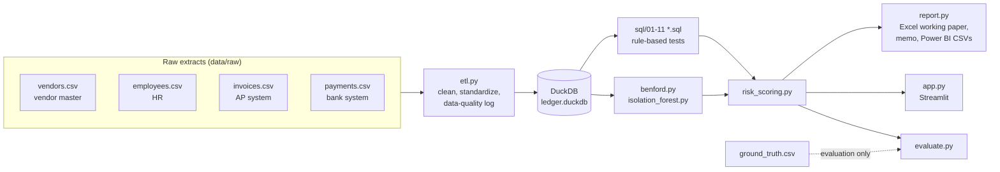

# Ledger Forensics

Forensic data analytics on accounts payable (AP): ingest messy extracts from four systems, clean them with a documented data-quality trail, run known fraud-pattern tests (mostly in SQL), rank the riskiest vendors and transactions, and produce working papers and a plain-language memo.

> **All data is synthetic.** Every person, company, address, bank account, tax ID and transaction is generated by `src/generate_data.py` with a fixed seed. No real people or companies are represented. Results describe "anomalies requiring further investigation", never conclusions of fraud.

## The problem

AP is one of the most common routes for occupational fraud and for costly error. Investigators rarely receive clean data: vendor master, HR, AP and bank records come from different systems, in different formats, with duplicates and gaps. The work is to reconcile them, test the full population against known schemes, prioritize what to look at first, and document every step so a reviewer, lawyer or regulator can follow it.

### AP schemes covered

| Scheme | What it looks like |
|---|---|
| Duplicate payments | The same invoice paid twice, re-entered, or resubmitted with a slightly altered number |
| Ghost vendor | A fictitious vendor set up to receive payments, often with an insider's bank account |
| Vendor-employee conflict | An employee secretly owns or controls a supplier |
| Split purchases / threshold avoidance | Purchases broken up or priced to stay under approval limits |
| Bank account diversion | A genuine vendor's payment sent to a different account |
| Segregation-of-duties breach | One person both creates a vendor and approves its payments |
| Fabricated amounts | Invented numbers that do not follow natural digit patterns |

## Architecture



## Tests

| # | Test | Detects | Why an investigator cares | Weight |
|---|---|---|---|---|
| 01 | Exact duplicate payment | Same invoice paid twice, or re-entered with the same number and amount | Most common AP loss; usually recoverable | 40 |
| 02 | Fuzzy duplicate payment | Same vendor and amount within 7 days; invoice numbers equal once formatting is removed; suffix resubmissions (`1588A`) | Altered numbers are how duplicates get past system controls | 25 |
| 03 | Round-dollar amount | Multiples of 100, 1,000 and above | Fabricated invoices are often round estimates | 5 |
| 04 | Just below approval threshold | Vendors with 3+ invoices within 5% under a limit | Avoids senior review | 15 |
| 05 | Split purchase | Same vendor, same day, each 80–100% of a limit, together above it | Bypasses approval limit | 25 |
| 06 | Vendor-employee match | Vendor address or bank account matches an employee (after normalization) | Undisclosed conflict of interest or shell company | 40 |
| 07 | Ghost vendor indicators | 3+ of: new in period, ≤10 invoices, ≥80% no PO, ≥50% round amounts | Fictitious vendor | 35 |
| 08 | Bank account mismatch | Payment account differs from vendor master | Payment diversion | 40 |
| 09 | Weekend / public holiday | Invoice or payment dated on a weekend or Singapore public holiday | Less likely to be reviewed | 10 |
| 10 | Segregation of duties | Vendor creator approved the payment | One person can create and pay a vendor | 25 |
| 11 | Amount outlier | More than 3 SD from the vendor's mean log amount (SQL) | Inflated or fabricated invoice | 10 |
| 12 | Benford's Law (vendor) | Vendor's first digits deviate (chi-square p < 0.001 and MAD nonconformity) | Invented numbers rarely follow natural patterns | 15 |
| 13 | Isolation Forest | Top 0.5% anomaly scores on 8 engineered features | **Supplementary signal only, not evidence** | 5 |

The SQL is kept close to standard PostgreSQL. Each file notes any dialect-sensitive parts (`MOD` on `NUMERIC`, `EXTRACT(DOW ...)`, date subtraction, `IS DISTINCT FROM`). The queries have been run on DuckDB only, not on a PostgreSQL server.

Benford results are reported overall (first digit and first two digits) and per vendor with 50+ invoices. With 20,000 records the chi-square test flags trivial differences, so MAD with Nigrini's conformity ranges is the primary overall measure. For a single vendor with ~100 invoices the opposite problem applies: MAD is noisy and most normal vendors fall in the "nonconformity" range. A vendor is therefore flagged only when the chi-square p-value is also below 0.001.

## Risk scoring

Weights are in `src/catalog.py`, one number per test, chosen by judgment to reflect how specific each test is to a real problem.

- **Transaction score** = sum of weights of the distinct transaction-level tests that flagged the invoice or its payment + half the weights of vendor-level tests that flagged its vendor.
- **Vendor score** = sum of weights of vendor-level tests (06, 07, 12) + the vendor's single highest transaction score.
- **Ties** are broken by value at risk (the transaction amount; for a vendor, all its spend if a vendor-level test fired, otherwise its flagged value), then by ID. The ranking is fully deterministic.

## Running it

Python 3.11+.

```bash
python3.11 -m venv .venv && source .venv/bin/activate
pip install -r requirements.txt

python -m src.pipeline          # generate data, ETL, tests, scoring, evaluation, outputs (~5 s)
python -m pytest                # 61 tests
python -m streamlit run app.py  # builds the data on first launch if it is missing
```

Individual steps: `python -m src.generate_data`, `python -m src.etl`, `python -m src.run_tests`.

Outputs:
- `outputs/working_paper.xlsx`: Summary (scope, sources, row counts, period, tests, run date, prepared/reviewed fields), Risk - Vendors, Risk - Transactions, one sheet per test, Benford (with chart), Data Quality, Evaluation (synthetic)
- `outputs/findings_memo.md`: plain-language memo for a non-technical reader
- `outputs/powerbi/*.csv`: 11 tidy tables (facts, dimensions, flags, risk rankings, Benford, data-quality log)

## Synthetic data

Seed 42, a Singapore-based company (SGD; day-first dates), 1 January 2024 – 31 December 2025.

| File | Rows | Deliberate messiness |
|---|---|---|
| vendors.csv | 300 | Mixed case, double spaces, trailing spaces, suffix variants ("Pte. Ltd.", "PTE LTD", "Private Limited"), abbreviated addresses, bank accounts with dashes/spaces, missing tax IDs, 3 companies entered twice |
| employees.csv | 150 | Blank approval limits for non-approvers, mixed address abbreviations |
| invoices.csv | 20,210 | Four date formats, lower-case and padded vendor IDs, 12 duplicated extract rows, 3 impossible dates, 4 missing amounts, blank descriptions |
| payments.csv | 20,203 | Amounts stored as text (`$1,234.50`, `SGD 1,234.50`, ` 1,234.50 `), two date formats, three bank-account formats, 5 missing approvers |

Amounts are drawn from per-vendor log-normal distributions; overall first-digit MAD is 0.0029 (close conformity to Benford's Law). One finance manager also has vendor-master access. That access conflict is what makes the planted segregation-of-duties scheme possible, and it also produces genuine but unplanted SoD hits (see evaluation).

226 planted records across 75 cases are saved in `data/ground_truth/ground_truth.csv`, kept out of `data/raw/` so the ETL and tests never see them:

| Scheme | Cases | Records |
|---|---|---|
| Exact duplicates (re-entered or paid twice) | 17 | 17 invoices |
| Near duplicates (same amount, 1–5 days later) | 10 | 10 invoices |
| Format duplicates (`INV-01001` / `INV01001` / `inv 01001` / `1588A`) | 10 | 10 invoices |
| Ghost vendors | 3 | 3 vendors, 15 invoices |
| Vendor-employee conflicts (incl. the 3 ghosts) | 7 | 7 vendors |
| Split purchases | 8 | 29 invoices |
| Threshold avoidance | 2 | 2 vendors, 22 invoices |
| Bank account mismatch | 10 | 10 payments |
| Weekend/holiday payment approved by vendor creator | 10 | 10 payments |
| Benford deviation | 1 | 1 vendor, 90 invoices |

## Data quality (ETL)

From the run's data-quality log:

| File | Rows in | Rows out | Dropped |
|---|---|---|---|
| employees.csv | 150 | 150 | 0 |
| vendors.csv | 300 | 300 | 0 |
| invoices.csv | 20,210 | 20,191 | 19 (12 duplicated extract rows, 3 invalid dates, 4 missing amounts) |
| payments.csv | 20,203 | 20,203 | 0 (7 orphaned by dropped invoices are kept and logged; 5 with no approver logged as a control exception) |

The log also identified 4 possible duplicate vendor-master records. Three are the planted re-entries. The fourth arose by chance in generation: a planted ghost vendor (V0296) received the same name as a long-standing vendor (V0077) but a different bank account. Reusing an existing vendor's name is a known ghost-vendor technique, so the data-quality step independently pointed at a ghost vendor.

## Evaluation

Because the fraud is planted, each test can be measured. This is only possible with synthetic data.

- **Recall** = planted records of the schemes the test targets that it flagged.
- **Precision** = share of its flags that are planted records of *any* scheme (an investigator following that flag would find a real problem).

| # | Test | Planted | Caught | Recall | Flagged | False positives | Precision |
|---|---|---|---|---|---|---|---|
| 01 | Exact duplicate payment | 17 | 17 | 100% | 22 | 0 | 100% |
| 02 | Fuzzy duplicate payment | 20 | 15 | 75% | 15 | 0 | 100% |
| 03 | Round-dollar amount | 15 | 15 | 100% | 136 | 121 | 11% |
| 04 | Just below approval threshold | 22 | 22 | 100% | 114 | 87 | 24% |
| 05 | Split purchase | 29 | 29 | 100% | 57 | 27 | 53% |
| 06 | Vendor-employee match | 7 | 7 | 100% | 7 | 0 | 100% |
| 07 | Ghost vendor indicators | 3 | 3 | 100% | 3 | 0 | 100% |
| 08 | Bank account mismatch | 10 | 10 | 100% | 10 | 0 | 100% |
| 09 | Weekend / public holiday | 10 | 10 | 100% | 87 | 77 | 11% |
| 10 | Segregation of duties | 10 | 10 | 100% | 46 | 26 | 43% |
| 11 | Amount outlier (vs all planted transactions) | 213 | 1 | 0% | 28 | 27 | 4% |
| 12 | Benford's Law (vendor) | 1 | 1 | 100% | 1 | 0 | 100% |
| 13 | Isolation Forest (vs all planted transactions) | 213 | 22 | 10% | 101 | 79 | 22% |

**Combined risk score**

| Measure | Result |
|---|---|
| Top 50 transactions that are planted records | 45 / 50 (90%) |
| Planted cases with at least one record in the top 50 | 30 / 71 (42%) |
| Planted records in the top 50 | 45 / 213 (21%); the top 50 cannot hold all 213 |
| Top 20 vendors with any planted activity | 19 / 20 |
| Vendor-level planted vendors (ghost, employee link, threshold, Benford) in the top 20 | 6 / 10 |
| Planted transactions flagged by at least one test | 213 / 213 (100%) |

**Reading these honestly**

- **Test 02 misses 5.** All five are case-only variants (`gr000330` vs `GR000330`), and test 01 catches them because it compares numbers case-insensitively. Together, tests 01 and 02 catch every planted duplicate.
- **Tests 03 and 09 over-flag heavily** (11% precision). Fixed-fee retainers are legitimately round, and some vendors date invoices on weekends. They carry low weights for this reason.
- **Test 10's "false positives" are real control breaches.** The dual-role finance manager approved normal payments to vendors they created. Those weren't planted fraud, but they are genuine segregation-of-duties exceptions an auditor would report.
- **Test 11 catches almost nothing.** Vendor amounts in this data vary widely (median spread 1.18 in log terms), so 3 standard deviations covers about a 35× range. Planted amounts, such as 9,800 at a vendor that typically bills 500, fall inside it. Per-vendor z-scores only work when a vendor's amounts are consistent.
- **The Isolation Forest finds 10% of planted transactions at 22% precision.** That's why it is supplementary, with the lowest weight.
- **The top-20 vendor list misses 4 planted vendors.** The two threshold-avoidance vendors and the Benford vendor are each flagged by a single low-weight test (15 points), and one employee-linked vendor ranks 22nd. Each would still be found on its test's own sheet.
- **Records versus cases.** The first 10 slots are all invoices from two ghost vendors, so the top 50 represents 30 of 71 cases. In practice an investigator works by vendor and by test sheet, not only down a single list.

**Changes made after the first evaluation** (reported so the numbers above aren't mistaken for first-pass results):

1. Test 02 originally missed suffix resubmissions (`1588A` vs `1588`). Recall went from 60% to 75% after adding the suffix rule (same vendor and amount within 60 days, one number extending the other).
2. The first vendor score summed every test that hit any of a vendor's transactions. Large vendors collected many one-off noisy hits and outranked vendors linked to employees, leaving 3 of 10 vendor-level planted vendors in the top 20. Two changes followed. The score now uses the vendor's highest transaction score instead of summing every hit. Ties are broken by value at risk instead of flagged value, which no longer penalizes vendor-level flags that have no flagged transactions. Result: 6 of 10.

These are design corrections, but they were made with knowledge of the ground truth. On a real engagement the equivalent step is calibrating on a prior period or a sample confirmed by investigation.

## Limitations

- **Synthetic data.** Real AP data has more varied legitimate patterns and less obvious fraud.
- **Known schemes only.** The tests find the patterns they were written for. Collusion with a real vendor, kickbacks, or fraud hidden in correct-looking documents would not be detected.
- **False positives.** Several tests flag far more legitimate items than suspicious ones. Every flag needs follow-up with documents and people.
- **Flags are not conclusions.** A flag shows an anomaly that needs explaining, nothing more.
- **Tuning knowledge.** Thresholds and weights were set by judgment and two were adjusted after seeing the evaluation (see above).
- **SQL portability** to PostgreSQL is by design, but untested.

## Possible extensions

- Fuzzy name matching (e.g. Jaro-Winkler) between vendor names and employee names or other vendors
- Vendor bank-account change history (change shortly before payment, then changed back)
- Credit notes, voids and reversals; payments without invoices
- Calibrating weights on a confirmed prior-period sample
- PostgreSQL CI job to prove SQL portability
- A Power BI report on the exported CSVs

## Screenshots

_Placeholder: Overview (metrics, flags by test, Benford chart)_

_Placeholder: Top-risk vendors_

_Placeholder: Vendor drill-down_

_Placeholder: Evaluation_

Current captures are in `docs/assets/`.

## Project structure

```
ledger-forensics/
  data/reference/          Singapore public holidays (2024-2025)
  data/raw/                generated source extracts (git-ignored)
  data/clean/              cleaned tables and data-quality log (git-ignored)
  data/ground_truth/       planted records, used only by evaluate.py (git-ignored)
  sql/                     01-11 detection tests, one per file
  src/
    generate_data.py  etl.py  run_tests.py  benford.py  isolation_forest.py
    risk_scoring.py  evaluate.py  report.py  pipeline.py  catalog.py  config.py
  app.py                   Streamlit app
  tests/                   pytest suite (61 tests)
  outputs/                 working paper, memo, Power BI CSVs (git-ignored)
```
